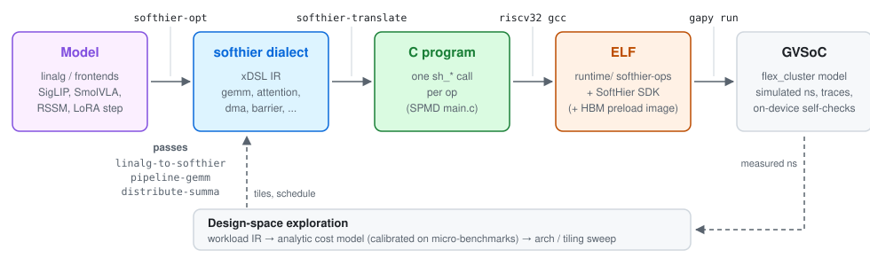
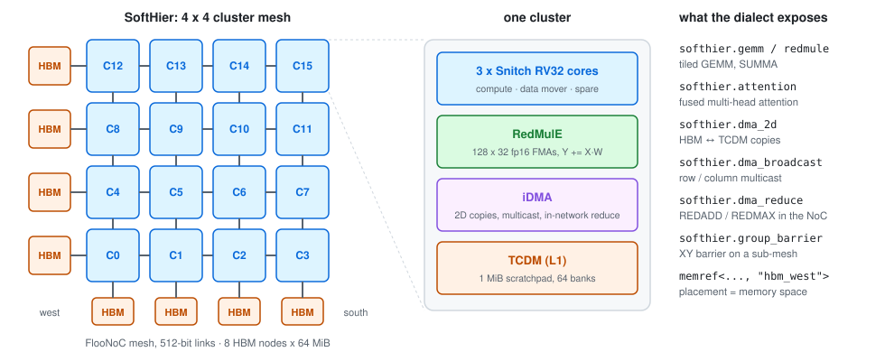
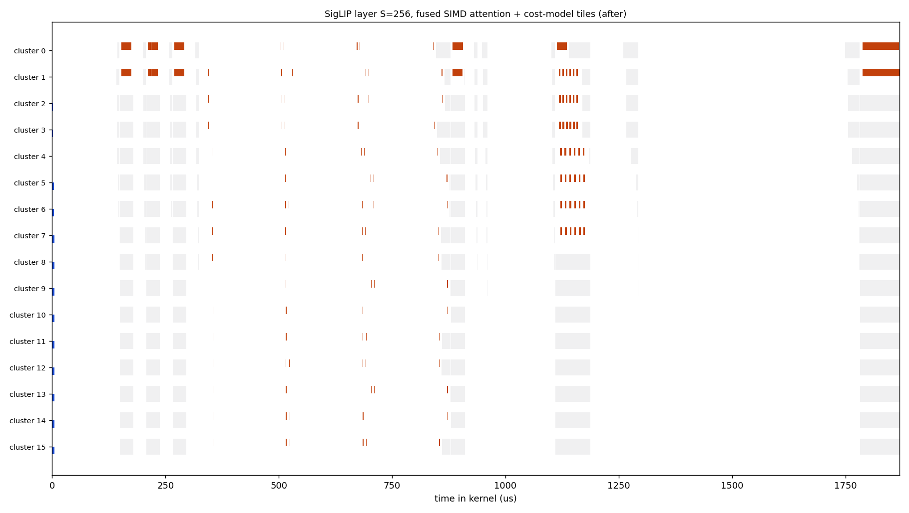

<h1 align="center">softhier-mlir</h1>

<p align="center">
  An <a href="https://github.com/xdslproject/xdsl">xDSL</a>/MLIR dialect, lowering flow and operator library for
  <b>SoftHier</b>,<br>a RISC-V many-cluster accelerator (RedMulE + iDMA + HBM) simulated in GVSoC.
</p>

<p align="center">
  <a href="https://github.com/runwangdl/softhier-mlir/actions/workflows/ci.yml"></a>
  
  
  
  <a href="LICENSE"></a>
</p>

<p align="center">
  <a href="#quick-start">Quick start</a> ·
  <a href="#a-first-program">A first program</a> ·
  <a href="#the-softhier-dialect">Dialect</a> ·
  <a href="#what-runs-today">Results</a> ·
  <a href="#the-stack-around-it">The stack</a> ·
  <a href="#documentation">Docs</a>
</p>

<p align="center">
  <picture>
    <source media="(prefers-color-scheme: dark)" srcset="docs/img/flow-dark.svg">
    
  </picture>
</p>

softhier-mlir takes a network written in `linalg` or emitted by one of its frontends, lowers it to a thin
`softhier` dialect, and emits a C program that calls an operator library (`runtime/`, "softhier-ops"). The
program is built with the SoftHier SDK and run on the SoftHier GVSoC model, where every result is checked
on the device or against a numpy / torch reference.

The bet: most of the SoftHier software stack can be expressed with mature MLIR dialects (`linalg`, `memref`,
`scf`), leaving a small accelerator dialect for the hardware operations that have no equivalent. Design
rationale: [`docs/DESIGN.md`](docs/DESIGN.md).

## Highlights

- **A whole VLA, end to end.** One SmolVLA inference (SigLIP vision, connector, 16-layer VLM prefix with KV
  cache, 10-step flow-matching action expert) runs on the simulated chip in 119.1 ms and matches lerobot's
  actions within 0.032.
- **Thin dialect, library backend.** One library call per op. Tiling, software pipelining and mesh-wide SUMMA
  are attributes that passes set, not hand-written C.
- **Training too.** Backward kernels and one LoRA step on the action expert, with every gradient checked
  against float64 torch autograd.
- **A cost model that drives the compiler.** An analytic model calibrated on micro-benchmarks picks GEMM
  tiles and ranks architecture knobs before anything is simulated.
- **Reproducible.** One Docker image holds the simulator, the toolchain and this repo.

## Quick start

### With Docker (simulator included)

```bash
git clone https://github.com/runwangdl/softhier-mlir && cd softhier-mlir
docker compose -f docker/compose.yaml build                 # about 15 min, 3.8 GB
docker compose -f docker/compose.yaml run --rm softhier     # shell in the mounted checkout
smoke                                                       # compiler tests + GEMMs + two examples on GVSoC
```

The image builds natively on arm64 (Apple Silicon) and amd64. What it contains and how it differs from a stock
SoftHier install: [`docker/README.md`](docker/README.md).

### Compiler only (no simulator)

```bash
python3 -m venv .venv && . .venv/bin/activate
pip install -e ".[dev]" numpy
bash tests/run_filecheck.sh          # 18 FileCheck tests
```

This gives you `softhier-opt` (parse, verify, run passes) and `softhier-translate` (dialect to C).

## A first program

A 512 x 512 x 512 GEMM in standard `linalg`, on matrices that live in HBM
([`examples/gemm512_linalg.mlir`](examples/gemm512_linalg.mlir)):

```mlir
%xh = softhier.hbm_buffer {offset = 0 : i32}       : memref<512x512xf16, "hbm_west">
%wh = softhier.hbm_buffer {offset = 524288 : i32}  : memref<512x512xf16, "hbm_south">
%zh = softhier.hbm_buffer {offset = 1048576 : i32} : memref<512x512xf16, "hbm_west">

linalg.matmul ins(%xh, %wh : memref<512x512xf16, "hbm_west">, memref<512x512xf16, "hbm_south">)
              outs(%zh : memref<512x512xf16, "hbm_west">)
```

Lower it, then translate it:

```bash
softhier-opt examples/gemm512_linalg.mlir -p linalg-to-softhier | softhier-translate /dev/stdin
```

The pass turns the `linalg.matmul` into `softhier.gemm %xh, %wh into %zh {fmt = "fp16"}`, and the backend emits
one call into the library:

```c
#include "sh_ops.h"
static void gemm512(void) {
    const uint64_t hb1 = sh_hbm_addr(0);        // 512x512xf16 HBM, 524288 B
    const uint64_t hb2 = sh_hbm_addr(524288);
    const uint64_t hb3 = sh_hbm_addr(1048576);
    { sh_gemm_cfg cfg = { .tm = 0, .tn = 0, .tk = 0, .pipeline = 0, .accumulate = 0, .fmt = SH_FP16, .l1_base = 0 };
      sh_gemm(hb1, hb2, hb3, 512, 512, 512, 512, 512, 512, &cfg, 0); }
}
```

Build it and run it on the simulator (inside the Docker image):

```console
$ python tests/gvsoc/run.py mlir examples/gemm512_linalg.mlir
PASS gemm512_linalg.mlir        passes=linalg-to-softhier                 roi=90926 ns wall=1.4s
     GEMM512_CHECK ok=262144/262144 GEMM512_PASS
```

`roi` is simulated time at 1 GHz. [`docs/TUTORIAL.md`](docs/TUTORIAL.md) walks through this flow and through adding
a new op from scratch.

## The target

<p align="center">
  <picture>
    <source media="(prefers-color-scheme: dark)" srcset="docs/img/chip-dark.svg">
    
  </picture>
</p>

SoftHier is a mesh of Snitch clusters. Each cluster has a RedMulE matrix engine that accumulates in place
(`Y += X·W`), an iDMA that can multicast along a mesh row or column and reduce inside the network, and a 1 MiB
scratchpad. HBM sits on the mesh edges. Every kernel written for it so far has the same shape: an
output-stationary SUMMA, RedMulE tiles, in-network broadcast and reduce, and a double-buffered pipeline. That
regularity is what makes a compact dialect workable.

## The `softhier` dialect

| Op | Meaning |
|---|---|
| `softhier.gemm %x, %w into %z {fmt}` | full HBM GEMM; the backend tiles it (`xmcast`: activation multicast once) |
| `softhier.redmule %x, %w into %y {fmt}` | one RedMulE tile, in place `y += x·w` |
| `softhier.attention %q, %k, %v -> %o {scale, heads, q_block}` | fused multi-head attention inside one cluster's TCDM, fp16 SIMD softmax |
| `softhier.dma_2d %src -> %dst` | strided HBM ↔ TCDM copy |
| `softhier.dma_broadcast` / `dma_reduce {kind}` | mesh row / column multicast, in-network REDADD / REDMAX |
| `softhier.group_barrier {grid_x, grid_y}` | two-phase XY barrier on a sub-mesh |
| `softhier.view` / `layernorm` / `softmax` / `gelu` / `add` / `add_bias` / `transpose` | strided HBM views and row-wise fp16 tensor ops |
| `softhier.rmsnorm` / `rope` / `silu_mul` / `pixel_shuffle` | the LLM-side ops of the SmolVLA prefix |
| `softhier.hbm_buffer` / `l1_buffer` / `hbm_fill` / `check_const` / `dump_samples` | buffers, test data, on-device self-checks |

Placement is carried by memref memory spaces: `"tcdm"`, `"remote_tcdm"`, `"hbm_west"`, `"hbm_south"`, `"hbm_north"`,
`"hbm_east"`. Passes: `linalg-to-softhier`, `pipeline-gemm`, `distribute-summa`.

## What runs today

All numbers are simulated on the SoftHier GVSoC: 16 clusters at 1 GHz with ideal HBM, so HBM-bound segments
are optimistic.

| Workload | Result | Details |
|---|---|---|
| SmolVLA inference, 1 camera x 256 tokens | 119.1 ms; actions within 0.032 of lerobot | [`SMOLVLA_E2E.md`](docs/SMOLVLA_E2E.md) |
| SmolVLA inference, 3 cameras | 178.7 ms; actions within 0.067 | [`SMOLVLA_E2E.md`](docs/SMOLVLA_E2E.md) |
| SigLIP vision tower, 12 layers, seq 256 | 2.29 ms per layer; every tensor at the fp16 floor against HF | [`SMOLVLA.md`](docs/SMOLVLA.md) |
| SigLIP vision tower, 12 layers, seq 1024 (512 x 512 image) | 14.86 ms per layer | [`SMOLVLA.md`](docs/SMOLVLA.md) |
| Fused attention against per-head attention | 0.55 against 0.83 ms (S = 256), 7.8 against 11.8 ms (S = 1024) | [`DSE.md`](docs/DSE.md) section 8 |
| Small-M GEMM with the activation multicast (`xmcast`) | flow step: HBM read -31 % (N = 1) / -52 % (N = 4), time -6 % / -14 % | [`XPANEL_MCAST.md`](docs/XPANEL_MCAST.md) |
| One LoRA step on the action expert | backward on the chip, gradients checked against float64 torch | [`TTT.md`](docs/TTT.md) |
| N expert candidates at once, on-chip RSSM imagination | cost curves | [`WORLD_MODEL.md`](docs/WORLD_MODEL.md) |

<p align="center">
  <br>
  <sub>One SigLIP layer (S = 256, fused attention, cost-model tiles) on 16 clusters: RedMulE activity per cluster,
  from <code>softhier_mlir.sim.trace</code>.</sub>
</p>

<details>
<summary><b>Commands for each workload</b></summary>

```bash
# library kernels and every example, self-checked on the simulator
python tests/gvsoc/run.py gemm
python tests/gvsoc/run.py mlir examples/*.mlir

# one SigLIP encoder layer through the compiler
python tests/gvsoc/run.py siglip-mlir --seq 256 --cluster all [--fused]
python -m softhier_mlir.frontend.siglip --layers 12 --no-test         # the dialect module of a 12-layer encoder

# SmolVLA's SigLIP tower with real weights (needs torch + transformers and the checkpoint)
python -m softhier_mlir.frontend.smolvla prepare --ckpt /app/models/smolvla_base/model.safetensors \
       --seq 256 --out /app/models/smolvla_base/vision_s256.npz
python tests/gvsoc/run.py smolvla --npz /app/models/smolvla_base/vision_s256.npz --layers 1

# the VLM text prefix (16 Llama layers, GQA, RoPE, token-class attention mask)
python -m softhier_mlir.frontend.smolvla prepare-vlm --cams 3 --out /app/models/smolvla_base/vlm_c3.npz
python tests/gvsoc/run.py smolvla-vlm --npz /app/models/smolvla_base/vlm_c3.npz --all-layers

# one inference end to end, then the 32-configuration cost table
python tests/gvsoc/run.py smolvla-e2e --npz /app/models/smolvla_base/e2e_c1_t256.npz --e2e-trace
python -m softhier_mlir.dse.e2e_cost --collect

# test-time adaptation: one LoRA step on the action expert
python tests/gvsoc/ttt.py ops | layer | expert --layers 16 --profile | reduce | dp --layers 4
```

Weights go into HBM through the simulator's preload path (`softhier_mlir/sim/preload.py`), so a network with real
weights needs no data generation on the device. The fp16 weights of SmolVLA (674 MiB) exceed the chip's 512 MiB
of HBM, so the inference is chained as four programs with an exact HBM hand-over.

</details>

## Design-space exploration

`softhier_mlir/dse/` turns a module into a shape-level workload, estimates it analytically for any architecture
(`Arch`: mesh size, RedMulE geometry, NoC width, TCDM, HBM), calibrates the constants on micro-benchmarks, and
sweeps knob grids, simulating only the top candidates. Fitted constants, model-against-simulation errors and
sweep results: [`docs/DSE.md`](docs/DSE.md).

```bash
python -m softhier_mlir.frontend.siglip --layers 12 --no-test | python -m softhier_mlir.dse.workload -
python -m softhier_mlir.dse.sweep --home /app/softhier_dse --params docs/dse/params.json \
    --arch noc_link_width=256,512,1024 --arch redmule_ce=64x64,128x32 --arch mesh=1x1,4x4 --top 12
```

Architecture sweeps rewrite the simulator's configuration, so they need a private copy of the SoftHier install
(`--home`).

## The stack around it

softhier-mlir is the compiler. It needs a simulator, an SDK and a toolchain, which come from these projects:

| Layer | Project | Role here |
|---|---|---|
| Simulator | [gvsoc/gvsoc](https://github.com/gvsoc/gvsoc), branch `bowwang-dev/softhier-deeploy` | the SoftHier `flex_cluster` model this repo runs on; [`gvsoc-core`](https://github.com/gvsoc/gvsoc-core) is the engine and ISS, [`gvsoc-pulp`](https://github.com/gvsoc/gvsoc-pulp) the PULP models |
| SDK | [pulp-platform/softhier-sdk](https://github.com/pulp-platform/softhier-sdk) | the public runtime (startup, linker script, `flex_*` headers). This repo currently builds against the variant shipped in the GVSoC branch above |
| Toolchain | [husterZC/gun_toolchain](https://github.com/husterZC/gun_toolchain) | prebuilt `riscv32-unknown-elf-gcc` 14.2 with V and Zfh |
| Sibling compiler | [pulp-platform/Deeploy](https://github.com/pulp-platform/Deeploy) | ONNX-to-C deployment; its container builds the same simulator (`make softhier`), which `docker/Dockerfile` follows |
| Compiler framework | [xdslproject/xdsl](https://github.com/xdslproject/xdsl) | the Python MLIR implementation the dialect, passes and tools are written in |
| Prior art | [KULeuven-MICAS/snax-mlir](https://github.com/KULeuven-MICAS/snax-mlir) | xDSL flow for Snitch + accelerators |
| Hardware | [RedMulE](https://github.com/pulp-platform/redmule), [iDMA](https://github.com/pulp-platform/iDMA), [Snitch](https://github.com/pulp-platform/snitch_cluster), [Spatz](https://github.com/pulp-platform/spatz), [FlooNoC](https://github.com/pulp-platform/FlooNoC) | the RTL blocks the GVSoC models stand for |
| Memory model | [DRAMSys](https://github.com/tukl-msd/DRAMSys) | HBM timing in the stock simulator; this repo uses GVSoC's ideal memory instead |
| Model | [lerobot SmolVLA](https://huggingface.co/lerobot/smolvla_base) | the reference network and checkpoint |

The simulator needs fixes that are not upstream. They are in [`docker/patches/`](docker/patches) and explained
in [`docs/SIMULATOR_NOTES.md`](docs/SIMULATOR_NOTES.md).

## Repository layout

```
softhier_mlir/
  dialects/softhier.py      the dialect: types and ops
  transforms/               linalg-to-softhier, pipeline-gemm, distribute-summa
  backend/emit_c.py         one library call per op; the generated main.c includes only runtime/sh_ops.h
  frontend/                 SigLIP, SmolVLA (vision, VLM prefix, expert, end to end, TTT), RSSM world model
  dse/                      workload IR, analytic cost model, calibration, sweep, tiling
  sim/                      GVSoC build + run, HBM preload images, trace to Perfetto / PNG
  tools/                    softhier-opt, softhier-translate
runtime/                    softhier-ops, the C library generated code calls (SPMD: every op runs on all cores)
examples/                   .mlir programs and the C generated from them
tests/filecheck/            compiler tests, no simulator needed
tests/gvsoc/                on-simulator tests: run.py, ttt.py, wm.py, micro-benchmarks
docker/                     Dockerfile, simulator patches, smoke test
docs/                       design, tutorial, ledgers with every measured number
```

## Documentation

| | |
|---|---|
| [`TUTORIAL.md`](docs/TUTORIAL.md) | generate and run a program; add a new op step by step |
| [`DESIGN.md`](docs/DESIGN.md) | the dialect abstraction and the lowering pipeline |
| [`DSE.md`](docs/DSE.md) | cost model, calibration, architecture sweeps |
| [`SIMULATOR_NOTES.md`](docs/SIMULATOR_NOTES.md) | what the stock GVSoC model gets wrong and how it is fixed |
| [`SMOLVLA.md`](docs/SMOLVLA.md), [`SMOLVLA_EXPERT.md`](docs/SMOLVLA_EXPERT.md), [`SMOLVLA_E2E.md`](docs/SMOLVLA_E2E.md) | the SmolVLA vision tower and prefix, the action expert, the chained inference |
| [`FLOW_DATAFLOW.md`](docs/FLOW_DATAFLOW.md), [`XPANEL_MCAST.md`](docs/XPANEL_MCAST.md) | dataflow of the flow-matching step; the activation-multicast GEMM |
| [`TTT.md`](docs/TTT.md), [`WORLD_MODEL.md`](docs/WORLD_MODEL.md) | backward pass and LoRA step; expert candidates and RSSM imagination |
| [`docker/README.md`](docker/README.md) | the Docker image |

## Status and limits

Research code, under active development.

- Numbers come from a simulator with ideal HBM, not from silicon or RTL.
- fp16 only on the RedMulE path. Long fp16 accumulations lose accuracy; the connector GEMM (K = 12288) is the
  largest error source in the SmolVLA chain.
- `runtime/` depends on the allocator and linker script of the SDK variant in the GVSoC `softhier-deeploy`
  branch, not on the public `softhier-sdk`.
- SmolVLA at fp16 does not fit the chip's HBM in one program, so the inference is four chained programs.

## License

Apache-2.0, see [`LICENSE`](LICENSE). The simulator, SDK and toolchain are separate projects under their own
licenses.
